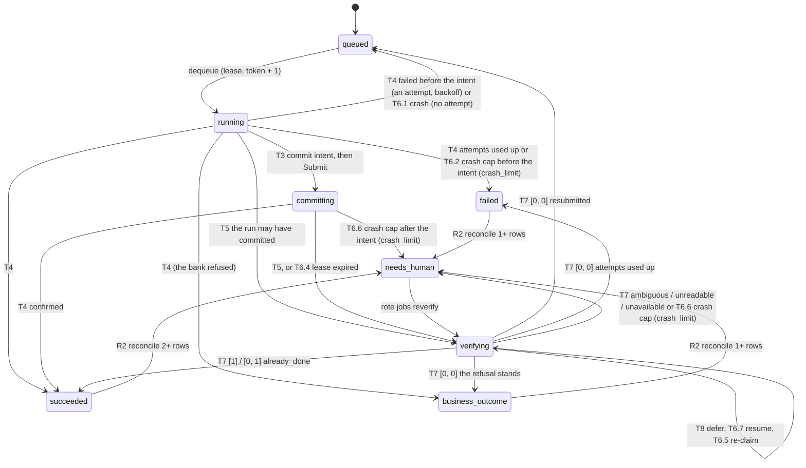

# rote

[](https://github.com/bhuvanb3110/rote/actions/workflows/ci.yml?query=branch%3Afleet%2Fday-1)

Computer-use automation for legacy bank/credit-union back-office web apps that have no API. An
LLM discovers a UI task once and compiles it into a typed, versioned **Capability** artifact;
that artifact then **replays deterministically, with no LLM in the loop**, and escalates to a
human on the same live browser session if it gets stuck. Record once, replay many. Saved
capabilities are also exposed as a discoverable, typed, callable surface — CLI or a real HTTP
API — that an AI agent can list and invoke by name, gated by a confidence/approval check that
refuses to run an unproven capability unattended.

## Setup

Prerequisites: Node 22+ (CI uses 22 LTS; `engines` says `>=22`).

```
npm install
npx playwright install chromium
copy .env.example .env
```

Open `.env` and set `ANTHROPIC_API_KEY` — this is needed **only** for the `discover` command
(see below). Then, in a separate terminal, start the mock target app:

```
npm run mock
```

This listens on `http://localhost:4100` (fake seed data — see [mock-app/README.md](mock-app/README.md)).

### Running the tests

From fleet Step 5 on, the full suite includes the Postgres job-queue tests, so start Postgres first
(Docker Desktop or any Docker engine with Compose):

```
docker compose up -d postgres     # postgres:17 on 127.0.0.1:55432, data in the pgdata volume
npm test                          # full suite; fails loudly (never skips) without Postgres
npm run test:unit                 # everything except the *.db.test.ts files, no Docker needed
npm run db:migrate                # apply db/migrations to the dev database (ROTE_DATABASE_URL)
```

The tests use a separate `rote_test` database (created on demand) with one schema per test file;
they never touch the dev `rote` database. `docker compose down -v` deletes the data volume.

`npm run typecheck` checks every file, tests and `scripts/` included (the build config excludes tests).
Three vitest projects (D31, D48): `unit-db` (everything that does not launch Chromium, fully parallel),
then `browser` and `slow` together, at most 3 files at a time, in one longest-first queue
(`vitest.browser-files.ts`, `vitest.sequencer.ts`; a guard test keeps the lists complete). `slow` holds
the integration files that mostly wait (leases, a slow bank, a 30 s outage, worker child processes);
`npm run test:fast` leaves it out for a quick local loop, never before a commit. Never run the suite
while the 4-worker fleet is up on an 8 GB machine; `crashSubmit.db.test.ts` binds the mock bank on :4100,
so the Compose bank must be stopped.

### CI

GitHub Actions (`.github/workflows/ci.yml`, D35) on every push and pull request to `main` and
`fleet/**`: **test** (Node 22, a `postgres:17` service, Playwright Chromium from the lockfile,
`npm run typecheck`, the full `npm test`, the full log uploaded as the `npm-test-log` artifact on every
run), **unit-node25** (the pure unit tests on Node 25), **docker** (builds the fleet image, never
pushed, with the Actions cache), **crash-matrix** (the crash-point matrix on Linux with real signals,
`--expect step-10`; since Step 10a no longer report-only: a red matrix fails the workflow; the report is
uploaded as the `crash-matrix-report` artifact and shown in the job summary) and **mutation-check**
(twelve planted bugs must each turn their tests red, D54). Every action is pinned by commit SHA.
Not in CI: the Day-1 exit and chaos; they need the Compose stack and minutes of wall time and run as
scripts with committed evidence (next section).

## Replay needs no API key

This is a deliberate design point, not an omission: `src/replay/replay.ts` never imports the
Anthropic SDK, and `ANTHROPIC_API_KEY` is only ever read inside the `discover` command. Once a
Capability artifact exists (a few are already committed under [artifacts/](artifacts/)), **every
`replay` and `operator` run below works with zero LLM dependency** — the production path has no
API cost, no model latency, and no LLM in the decision loop at all.

## Demo path

Run these in order, with `npm run mock` already running in another terminal. `--params` takes a
JSON object; in PowerShell, escape the inner double quotes with `\"` inside a single-quoted
string exactly as below (plain `'{"a":"b"}'` gets mangled by cmd.exe on the way to `npx` — the
Bash equivalent doesn't need the backslashes).

**1. Discover the member-lookup capability** (needs `ANTHROPIC_API_KEY`; opens a real Chromium
window and drives it live):

```
npx tsx src/cli/index.ts discover
```

This uses the default goal ("look up member 10001 and read their current savings balance")
against `http://localhost:4100` and writes a new `artifacts/member-lookup.json` plus an evidence
run under `evidence/`.

**2. Replay it — success:**

```
npx tsx src/cli/index.ts replay --artifact artifacts/member-lookup.json --params '{\"username\":\"operator\",\"password\":\"operator\",\"memberId\":\"10001\"}'
```

Logs `replay: success` with `outputs.savingsBalance`. No API key needed.

**3. Replay it — unknown member (business outcome, not a crash):**

```
npx tsx src/cli/index.ts replay --artifact artifacts/member-lookup.json --params '{\"username\":\"operator\",\"password\":\"operator\",\"memberId\":\"99999\"}'
```

Logs `replay: did not succeed` with `status: "business_outcome"`, `code: "NO_SUCH_MEMBER"` — a
recognized, caller-branchable outcome the artifact was compiled to detect, distinct from a
`failure`. (The CLI still exits non-zero for any non-`success` status, including this one — check
`status`/`code` in the JSON log, not just the exit code.)

**Result contract.** Every replay returns one of four statuses: `success`, `business_outcome`,
`needs_human`, `failure`. A non-`success` result may also carry **`commitUncertain`**
(`{irreversibleStepId, detail}`), which means the run already *attempted* its irreversible step
(e.g. the transfer's Submit). The commit may have happened, so check the bank's history before any
retry. If a non-success result has no `commitUncertain`, nothing irreversible was attempted and a
retry is safe. The CLI also logs a separate warning line, `commit may have happened at <step> --
verify before retrying`. The catalog HTTP API returns the field unchanged in its 200 body. Once the
irreversible step has been attempted, replay never reloads, never retries that step, and turns
unexpected errors into `failure`/`unknown` with the marker. See
[docs/DECISIONS.md](docs/DECISIONS.md) D10.

**4. Human-in-the-loop escalation demo:**

```
npx tsx src/cli/index.ts operator --artifact artifacts/open-sub-account-confirmed.json --params '{\"username\":\"operator\",\"password\":\"operator\",\"memberId\":\"10001\",\"initialDeposit\":\"50.00\"}'
```

This artifact's last step is a real, irreversible "Confirm" click, which replay refuses to run
unattended. A headed Chromium window opens and runs up to that step, then pauses. Open
`http://localhost:4200` in a browser:

1. Click **Take control** — the console shows the pending step, the reason, and a screenshot.
2. Switch to the automation's own Chromium window and click **Confirm** yourself — same live
   browser session, not a new one.
3. Back in the console, optionally add a note, then click **Hand back**.
4. Watch the terminal: replay re-perceives the page, sees the capability's success condition now
   holds, and logs `operator: success` — resumed in place, not restarted.

## Agent-facing capability catalog

Every saved artifact under `artifacts/` is also exposed as a discoverable, typed, callable
surface an AI agent could use — not just something a human replays by file path. `catalog list`
returns each capability's id/name/description plus a JSON-Schema-shaped view of its typed
inputs/outputs, generated straight from the artifact so it can never drift out of sync; `catalog
invoke` validates params against that same schema and replays it through the exact same
`runReplay` path as `replay`/`operator` above.

```
npx tsx src/cli/index.ts catalog list
npx tsx src/cli/index.ts catalog invoke member-lookup --params '{\"username\":\"operator\",\"password\":\"operator\",\"memberId\":\"10001\"}'
```

The same two operations are also a real HTTP API, not just a CLI trick:

```
npx tsx src/cli/index.ts catalog serve
```

```
curl http://localhost:4300/capabilities
curl -X POST http://localhost:4300/capabilities/member-lookup/invoke -H "content-type: application/json" -d "{\"params\":{\"username\":\"operator\",\"password\":\"operator\",\"memberId\":\"10001\"},\"entryUrl\":\"http://localhost:4100\"}"
```

Fastest way to see it end to end — a small script that lists capabilities over HTTP, picks one by
name, and invokes it with typed args, the way a tool-calling LLM would:

```
npm run demo:agent
```

A saved run of exactly this is committed at
[evidence/catalog-agent-invoke/](evidence/catalog-agent-invoke/).

## Confidence & approval gating

A freshly discovered capability starts in `draft` and is refused for **unattended** replay —
`needs_human`, before any browser even launches — until it's proven reliable through repeated
high-confidence runs; every promotion decision is logged to a per-capability history file and is
auditable, never silent. (The 3 artifacts committed under `artifacts/` predate this gate and are
grandfathered `approved`, which is why every command above works with no extra flag.)

**Approvals are bound to the artifact version** (docs/DECISIONS.md D15). Every approval records
`approvedVersion`, and an artifact whose `version` differs from it is refused (`needs_human`:
"approved for 1.0.0, artifact is 1.1.0; re-approve"), so editing and re-versioning an artifact never
silently inherits its old approval. `catalog approve <id>` takes the version from the artifact on
disk. A status file with no `approvedVersion` (written before this rule) is still allowed and the
gate says it is grandfathered; all committed status files now name their version.

**…and to the artifact's content** (D24). Every approval also records `approvedDigest`, the
SHA-256 of the artifact's canonical JSON (keys sorted, no whitespace, after schema validation). An
artifact edited without a version bump is refused too ("artifact content changed since approval;
re-approve"), while re-indenting the file or switching CRLF/LF changes nothing. A status file
with no digest falls back to the version check, and the gate's reason says so. All committed
status files carry a digest, and `src/catalog/committedApprovals.test.ts` fails if any committed
artifact no longer matches its approval.

```
npx tsx src/cli/index.ts replay --artifact artifacts/member-lookup.json --params '{\"username\":\"operator\",\"password\":\"operator\",\"memberId\":\"10001\"}' --approve-unattended
npx tsx src/cli/index.ts replay --artifact artifacts/member-lookup.json --params '{\"username\":\"operator\",\"password\":\"operator\",\"memberId\":\"10001\"}' --show-confidence
```

`--approve-unattended` opts a single run of a still-`draft` capability in (this is how a new
capability's history accumulates in the first place); `--show-confidence` prints the run's
confidence score, computed from how far down its own ranked locator strategies each step
resolved. Both flags exist on `catalog invoke` too. Once enough consecutive high-confidence runs
have landed, a capability auto-promotes to `approved` — or a human can promote it directly:

```
npx tsx src/cli/index.ts catalog approve member-lookup --reason "manually verified, safe to run unattended"
```

A saved run of the full sequence — refused while `draft`, promoted after qualifying runs, then
replaying unattended with no flag at all — is committed at
[evidence/confidence-approval-gate/](evidence/confidence-approval-gate/).

## Fleet (Day 1): a job queue, workers and an async API

Single machine, Docker Compose (docs/FLEET_BRIEF.md; design in docs/plans/step-05.md and
step-06.md). Postgres holds the jobs; each worker container runs one Chromium and pulls jobs with
`SELECT … FOR UPDATE SKIP LOCKED`, at most 2 at a time per tenant; one mock-bank container is the
source of truth (its in-memory ledger).

```
cp .env.example .env              # once; fake per-tenant bank credentials (ROTE_CRED_*)
docker compose up -d --build      # postgres, bank, api (:8080), 4 workers (ROTE_WORKERS)
npm run evidence:day1             # the Day-1 exit: 100 jobs, ledger-checked (evidence/fleet-day1-exit/)
```

**Async invoke** (the synchronous `POST /capabilities/:id/invoke` is unchanged):

```
curl -X POST "http://127.0.0.1:8080/capabilities/transfer/invoke?mode=async" \
  -H "Idempotency-Key: order-42" -H "content-type: application/json" \
  -d '{"tenant":"tenant-a","params":{"memberId":"10001","toMemberId":"10002","amount":"1.00"}}'
# 201 {"jobId":…,"state":"queued","memoKey":"rote-<jobId>","links":{"self":"/jobs/<jobId>?tenant=tenant-a"}}
curl "http://127.0.0.1:8080/jobs/<jobId>?tenant=tenant-a"
```

- The same tenant + key + request returns the same job (200); the same key with a different
  request is 409. The body is `tenant` + `params` only: credentials are injected per tenant by the
  worker and never stored, the transfer's memo is the job's `memoKey`, and run-time approvals are
  never taken from a client (400). A capability not approved for its current version and content is
  422 at enqueue; the worker checks again at run time.
- **`?tenant=` is NOT authentication.** This project has no authentication, by scope. The tenant is
  whatever the caller says; scoping `GET /jobs/:id` by it only stops one tenant from reading
  another's job by id (another tenant's job is a 404, same as a missing one). Every port is bound to
  127.0.0.1.
- A job ends `succeeded`, `business_outcome` (the bank refused: final, never retried), `failed`, or
  `needs_human`. ~~`outcome: "commit_uncertain"` means the Submit may have gone through: it is never
  retried, and someone must check the bank's history for the `memoKey`.~~ **Since Step 9** a job whose
  Submit may have gone through is **verified** in the bank's history by its `memoKey` (see "Fleet
  (Day 2): crash safety" below), and it ends `succeeded` / `already_done`, resubmitted, or
  `business_outcome`. `needs_human` now means verify could not decide: `ambiguous` (2+ matches),
  `unreadable` or `verify_unavailable` (the bank stayed down past the budget). Or the job hit its crash
  cap after the intent: `crash_limit` (`verify_exhausted` before D58). A job parked by Steps 6–8 can be
  handed to verify with `npm run jobs -- reverify <jobId>`.
- ~~**Day-1 limits, on purpose:** leases are taken but not heartbeated, and nothing recovers a dead
  worker's job yet.~~ **Since Step 8:** a 30 s lease with a 10 s heartbeat, the fenced commit intent,
  and recovery before every dequeue (see "Fleet (Day 2): crash safety" below). A worker killed with SIGKILL (or OOM)
  stops heartbeating. Within lease + one poll, another worker requeues its job if it died before the
  intent. If it died after, Step 8 parked the job `needs_human`; since Step 9 the recovering worker
  verifies it. `docker compose stop` is graceful: the in-flight job gets 30 s, then is aborted and
  recorded.

Measured (evidence/fleet-day1-exit/check.txt, `RESULT: PASS`): 100 transfer jobs on 4 workers in
102.6 s, all succeeded on the first attempt, exactly one ledger row per job, 0 duplicates, 0 lost.
Peak memory per worker was about 260 MiB. Re-run on the shared ledger oracle in Step 7
(evidence/fleet-day1-exit-oracle/): `RESULT: PASS` again, 84.0 s.

## The judges: the ledger oracle, chaos and the crash-point matrix

Correctness is judged only by the mock bank's own ledger, matched to jobs by `memoKey` (D32). One
module decides every verdict, for every harness:

```
npm run oracle -- --drain-timed-out --out <dir>   # any time: jobs in Postgres vs GET /control/ledger
npm run chaos -- --seed <n>                       # Compose fleet, seeded kills + a 45 s pause (D33)
npm run crash-matrix                              # kill a worker at each of 16 transfer boundaries (D34),
                                                  # plus 7 two-fault recovery scenarios (Step 9)
npm run verify-scenarios -- --family lag|outage   # verify vs a lagging history / a 30 s bank outage (Step 9)
```

- **Oracle verdicts:** DUPLICATE (2+ rows for a job, whatever its state), MISSING_COMMIT
  (`succeeded`, no row), UNRECORDED_COMMIT (`failed`/`business_outcome`, but a row), MISMATCH (wrong
  `confirmationRef` or tenant), LOST (non-terminal after the drain, with its row count), ORPHAN (a row
  no job owns). `needs_human` may have 0 or 1 row and is listed. The report ends in `RESULT: PASS` or
  `RESULT: FAIL`.
- **Chaos** (`scripts/chaos.ts`): the seed fixes the schedule (kill times, victims, the pause), not
  the interleaving. The harness is the supervisor (`docker start` after each kill), never touches
  Postgres or the bank, and stops the fleet at the end.
- **Crash-point matrix** (`scripts/crash-matrix.ts`): per point a fresh test schema, an in-process bank
  on :4100 (stop the Compose bank first), one job, a worker child process with
  `ROTE_FAULT=<point> ROTE_FAULT_ENABLE=1` that SIGKILLs itself there, then a clean worker and the
  oracle. The fault flag is refused without the enable flag, so it can never fire by accident.

**Before Day 2 these failed, on purpose, and those failures are the "before" evidence** (the brief:
write them first, even though they will fail):

| Judge | Result (Step 7) | Why |
| --- | --- | --- |
| `evidence/chaos/before-day2/` (seed 2024306878) | **RESULT: FAIL**: 61 ok, **39 LOST** (one after commit), 0 duplicates | a killed worker's job stays `running` forever and holds its tenant slot; tenant-a stalled after 16 s |
| `evidence/crash-matrix/before-day2/` | **1/16 green**: LOST at every point but `after-complete`; 1 ledger row from `after-submit` on | the lease expires (30 s, the drain was 40 s) but nothing recovers it |

**0 duplicates here proves nothing.** A duplicate needs a second runner of the same job, and before Day
2 nothing ever re-runs a dead worker's job. Day 2 (heartbeat, the fenced commit intent, recovery, verify
through the history page, the reconcile pass) is what these same scripts then judged green: below.

## Fleet (Day 2): crash safety

### The problem

A transfer is one click on the bank's Submit button, and the bank's form has no idempotency key. The fleet
runs that click from worker processes that can be killed (`SIGKILL`, OOM) or frozen (`docker pause`) at any
point, and the bank cannot tell a retry from a second transfer. The fleet must still deliver: **every job
ends, and no transfer happens twice**. When it cannot know whether a click went through, it must find out
from the bank, never guess, and never leave it silent.

### The design

- **Leases, heartbeat and fencing** (D36, D22). A worker holds a job by a 30 s lease on the database's clock,
  extended every 10 s by its heartbeat, never revived once expired. Every lease bumps the job's fencing
  token, and every write a worker makes is fenced on it, so a worker that lost its job cannot change it.
- **The commit intent** (D37). Right before Submit the worker writes a fenced intent; only if that commits
  does the click happen. Before the intent nothing irreversible has happened and the job can simply run
  again. After it, the job is **never retried blindly**.
- **Recovery** (D38) runs before every dequeue. Every expired lease is a worker **death**, and every death counts
  against the job's one **crash budget** (5, D58): before the intent, in the middle of a verify, anywhere. A
  death before the intent requeues the job at once and uses **none** of its attempts (D57). A death after the
  intent is **verified**. The death that reaches the cap ends the job as `crash_limit`: `failed` before any
  intent (nothing irreversible happened), `needs_human` after one (the Submit may have committed).
- **Verify** (D42–D47) searches the bank's own transfer history for the job's `memoKey`. If it counts 0, it
  waits the settle period and looks again. `[1]` or `[0, 1]`: the transfer happened, so `succeeded` /
  `already_done`. `[0, 0]`: it did not, so it is resubmitted (the only retry after an intent) or, if the bank
  had refused after Submit, the refusal stands. 2+ matches or an unreadable page: `needs_human`. The bank
  unavailable: the verify defers and resumes with a backoff, for up to 10 minutes.
- **Two budgets** (D49, D57, D58). *Attempts* (3) are the job's own failures, retried with a backoff of 10 s,
  then 30 s (jittered), so a 30 s bank outage fails no job. *Crashes* (5) are every worker death on the job, so
  a poison job (one that kills every worker that runs or verifies it) ends visibly instead of looping.
- **The reconcile pass** (D50, D55). A job that ended after a `[0, 0]` verify is the only kind a frozen
  worker's late click can still land on. It is re-read once, lease + settle + margin later: the count must
  match what the job says (1 row for `succeeded`, 0 for `failed` / `business_outcome`). Anything else moves
  it to `needs_human` / `duplicate_suspected` or `unrecorded_commit_suspected`, with a metric and an
  error-level log line. `npm run reconcile -- --since 24h` re-reads the whole window at the end of the day
  (D51). A reconciler's deaths are not the job's crashes. They are counted apart, and after `max_crashes` of
  them the pass **abandons** the job's reconcile: it keeps its state, gets `reconcile: "abandoned"`, and the
  pass logs it and counts it (`reconcile_abandoned_total`). The end-of-day batch still re-reads it (D59).



Every decision above is a pure function in `src/fleet/stateMachine.ts`. The SQL only executes it and repeats
its guards. A model of the `jobs` table (`src/fleet/model.ts`) mirrors each statement. Property tests drive
the model with crashing, freezing workers and a lagging, failing bank, 10 000 sequences per property. A
model-vs-real test runs the same random commands against the real SQL and compares every row after every
command. The mutation check plants 12 known bugs and requires each to turn its tests red.

### What is guaranteed, and the one window

The property tests state the guarantees (`src/fleet/stateMachine.property.test.ts`):
- **No blind retry after the intent** (property 5): every requeue past an intent went through a verify that
  looked twice and saw 0.
- **No duplicate** unless a worker clicked with a lease that was no longer valid, or the bank's history lags
  more than the settle period (property 1). Both conditions are shown to be necessary.
- **No lost job** (property 3): after the faults stop, every job reaches a terminal state and is settled.
- **A job is never failed or escalated by worker deaths before 5 of them**, never failed by fewer than 3 of its
  own failures, and never failed past its intent (property 11).
- **No duplicate or unrecorded commit stays silent** after the reconcile pass, unless the row appeared after
  the pass read the history or the pass abandoned the job (properties 8, 10), and **none at all** after the
  end-of-day batch (property 9).
- **A reconciler's deaths never touch the job's own crash budget**, and the pass abandons a reconcile only
  after 5 of them (property 12).

The randomized tests print how often each path was reached, so a path they never exercise shows up in every
test log.

**The one window:** a worker frozen after its intent, past its lease plus the settle period, can wake and click
after another worker verified `[0, 0]` and resubmitted. The bank has no lease to check, so no client can close
this window. It is **made loud** instead: the reconcile pass finds the second row and flags the job
(`evidence/zombie-window-limit/` stages it and shows the duplicate AND its detection).

### Results

| Judge | Evidence | Result |
| --- | --- | --- |
| **The Day-2 exit.** Chaos at scale: 20 seeds × 500 jobs, 4 workers, kills every 5–15 s, a 45 s pause (standard family), all on one commit | [`chaos/day2-exit-final/`](evidence/chaos/day2-exit-final/README.md) ([`tally.md`](evidence/chaos/day2-exit-final/tally.md); checked before commit: [`step-11/`](evidence/step-11/day2-exit-final-check.txt)) | **20/20 seeds passed: 10,000 jobs, 1,582 kills, 0 duplicates, 0 lost**, 9,999 succeeded. 1 job ended `needs_human` / `crash_limit` with **0 ledger rows**: its worker died 0.6 s after the intent, then 4 verifiers in a row were killed by the schedule before a lookup. Every death is attributed, so this is a pass with 1 escalation, not a plain pass. 548 crash requeues used no attempt; 99 jobs verified after a death past the intent (89 `already_done`, 9 resubmitted and reconciled `[1]`, 1 escalated) |
| The same standard family on 2 seeds, before and after D58 | [`chaos/day2-exit/`](evidence/chaos/day2-exit/README.md) and [`…-after-d58/`](evidence/chaos/day2-exit-after-d58/README.md) | **FAIL before D58** (1 of 2): one job went to `needs_human` after its worker and all 3 of its verifiers were killed. **PASS after**, on the same 2 seeds: 1000/1000 ok, 0 duplicates, 0 lost, 0 `needs_human` |
| The bank down 30 s and slow 60 s, no kills | [`chaos/bank-fault-only-seed-2130356189-after-d57/`](evidence/chaos/bank-fault-only-seed-2130356189-after-d57/) | **PASS**: 100/100 succeeded, 0 failed, 0 duplicates, 0 lost; 101 attempts requeued with the backoff |
| The bank down and slow, plus 16 kills and the pause | [`chaos/bank-fault-kills-seed-41379566/`](evidence/chaos/bank-fault-kills-seed-41379566/README.md) (before) and [`…-after-d57/`](evidence/chaos/bank-fault-kills-seed-41379566-after-d57/) | **FAIL before D57**: 2 jobs failed, their attempts used up by kills. **PASS after**, on the same seed: 100/100 succeeded, 0 failed, 0 duplicates, 0 lost; 3 jobs ran a 4th time because their crashes used no attempt |
| Crash-point matrix, production timing (lease 30 s, heartbeat 10 s): a kill at each of 16 transfer boundaries + 7 two-fault recovery scenarios | [`crash-matrix/step-10-production-30-10/`](evidence/crash-matrix/step-10-production-30-10/README.md) | **PASS, 23/23**, 1 ledger row in every scenario: the pre-intent points requeued without using an attempt; `before-submit` resubmitted `[0, 0]` and reconciled `[1]`; the post-click points `already_done`; every killed verifier re-claimed and decided |
| The same matrix at 5 s / 2 s on the Step 10b code | [`crash-matrix/step-10b-final-5-2/`](evidence/crash-matrix/step-10b-final-5-2/README.md) | **PASS, 23/23**, 1 ledger row in every scenario: the pre-intent points requeued without using an attempt; `before-submit` and its variants resubmitted `[0, 0]` and reconciled `[1]`; the post-click points `already_done` |
| A crash right before / after Submit, in `npm test` and CI (real SIGKILL on Linux) | `src/worker/crashSubmit.db.test.ts`; the CI `crash-matrix` job | exactly 1 ledger row each: resubmitted on attempt 2 / `already_done` on attempt 1 |
| The zombie window | [`zombie-window-limit/`](evidence/zombie-window-limit/) | **PASS**: the duplicate happens (2 rows) and is flagged `needs_human` / `duplicate_suspected` |
| The history lagging past the settle period; a 30 s outage during verifies | [`step-10/verify-scenarios/`](evidence/step-10/verify-scenarios/) | **PASS**: the lag's `[0, 0]` duplicates are flagged by the reconcile pass; every deferred verify decided after the outage |
| Planted bugs | [`mutation-check/`](evidence/mutation-check/report.md) and its CI copy [`ci-linux/`](evidence/mutation-check/ci-linux/README.md); since Step 12b, [`step-12b/mutation-check/`](evidence/step-12b/mutation-check/report.md) | **12/12** caught on the Day-2 code, each by its named tests, on Windows and in CI (run 44425004620). Step 12b added mutant 13 (the error handler logs `err.message`): **13/13** on Windows. In CI on every push |
| This README, from a fresh clone | [`clean-clone-check/`](evidence/clean-clone-check/README.md) | **PASS**: `npm ci`, `docker compose up -d --build`, then `npm run chaos -- --seed 757102590`: 100/100 succeeded, 0 duplicates, 0 lost |

The full before / after, step by step, is in the [evidence index](evidence/README.md).

### Operating it

- **`settled` and `reconcile`.** `GET /jobs/:id` returns `settled: true` once the job is terminal and no
  automatic reconcile is still to run. A `succeeded`, `failed` or `business_outcome` job that is not yet
  settled can still change to `needs_human`. Treat the state as final only when `settled` is true. `reconcile`
  says which kind of settled it is: `none` (the job never needed one), `pending` (not settled yet),
  `reconciled` (the bank's history agreed with the job), `flagged` (it moved the job to `needs_human`), or
  **`abandoned`**. **Settled with `reconcile: "abandoned"` means no automatic check will run again, but the
  end-of-day `rote reconcile --since` still can.** Such a job is settled without having been confirmed
  duplicate-free. The job also shows `notBefore` (its backoff), `crashes`, `leaseCrashes`, `maxCrashes`,
  `reconcileCrashes` and `reconcileAbandonedAt`.
- **`needs_human` says why** in `outcome`: `ambiguous`, `unreadable`, `verify_unavailable`, `crash_limit` (the
  crash cap after the intent), `duplicate_suspected`, `unrecorded_commit_suspected`, `reconcile_unreadable`
  (`verify_exhausted` on jobs escalated before D58). `npm run jobs -- reverify <jobId>` hands a "could not
  tell" `needs_human` job back to verify (never `ambiguous`; a `failed` / `crash_limit` job, which never
  reached its intent, is refused).
- **`ROTE_VERIFY_SETTLE_MS` (default 5000) must exceed the bank's history visibility delay** (D47); otherwise
  `[0, 0]` can be wrong (`evidence/settle-vs-history-lag/`). Also `ROTE_VERIFY_DEFER_BACKOFF_SECONDS` (5),
  `ROTE_VERIFY_DEFER_BUDGET_SECONDS` (600) and `ROTE_RECONCILE_MARGIN_SECONDS` (25: the reconcile runs 60 s
  after the job ends).
- **One command per judge:** `npm run chaos -- --seed <n> [--bank-fault [--no-kills]]` (one seeded run of 100
  jobs, its evidence in `evidence/chaos/`); `npm run chaos-seeds -- --seeds 20 --jobs 500 --out
  evidence/chaos/day2-exit-final` (the unattended batch. `--out` is required, and a folder holds one commit's
  seeds: the runner refuses to mix commits, D60. Rerun the same command on the same commit to resume. The tally
  is `tally.md` in that folder); `npm run crash-matrix -- --lease-seconds 30 --heartbeat-seconds 10 --expect
  step-10`; `npm run mutation-check`.

### Honest limits

- **The zombie window is detected, not closed** (above). The reconcile pass has its own limit: a zombie
  frozen longer than the reconcile delay that also beats its heartbeat on waking clicks after the pass read the
  history; the end-of-day batch is what finds that one (D51).
- **Bad luck alone can reach the crash cap.** Under chaos-level kill rates, 1 job in the 10,000 of the 20-seed
  batch went to `needs_human` / `crash_limit`: five scheduled kills in a row hit it (its worker right after the
  intent, then four verifiers). It had no ledger row, so the transfer had not happened, but a person had to be
  asked. The cap (5, D58) is what stops a real poison job from looping, so the fleet cannot tell the two apart.
  `rote jobs reverify` hands such a job back to verify.
- **An abandoned reconcile is settled, not confirmed.** If 5 reconcilers die on one job, no automatic check
  re-reads it again; only the end-of-day batch can still find a late duplicate on it (`reconcile: "abandoned"`
  says so, D59).
- **The settle period must exceed the history lag**, a deployment setting the fleet cannot check by itself.
- **The verify lookup reads only the first match's reference**: a `duplicate_suspected` job carries the count
  and the first reference; the other is in the reconcile's screenshot and the ledger. Reading every match is
  lookup 1.3.0, deferred to Day 4.
- **A single machine**, Docker Compose, one Postgres; **a mock bank** with fake data; no authentication (by
  scope). Multi-machine stays design-only (REPORT.md).
- **Longer bank outages** than the backoff schedule (about 32 s) can still fail jobs; that is Day 4's
  circuit breaker.

## Saved demonstration runs

Real, unedited evidence from runs of all four scenarios above — logs, screenshots, and an index
of what to look for in each — is committed under [evidence/](evidence/README.md).
